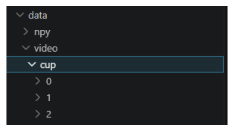
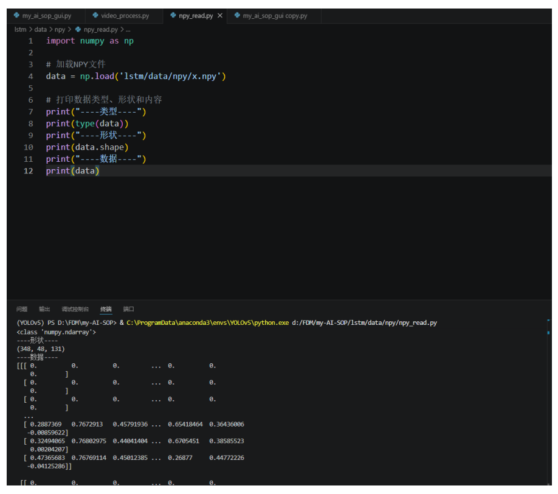
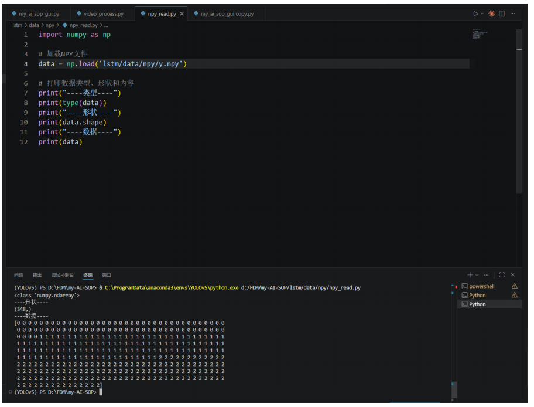
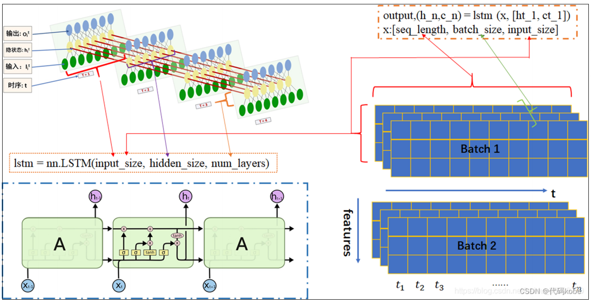
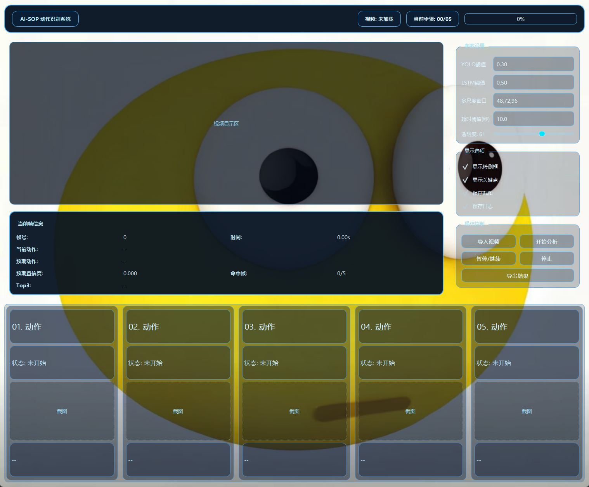

# AI-SOP 动作识别系统

> 一个面向装配场景的 SOP（Standard Operating Procedure）动作识别项目。  
> 支持从 **数据标注 → YOLO → 特征提取 → LSTM → GUI实时演示** 的完整闭环复现。

---


首先感谢原作者：https://gitee.com/volara/AI-SOP
我们在原始项目上做了一些开发和适配。

下面是我们做的一些内容：
自定义的数据集路径：D:\FDM\my-AI-SOP\lstm\data。这里路径大家自己根据自己实际路径改一下前缀D:\FDM\。收集数据后需要将每个流程切片后分类到不同的
类别目录中，方便后续训练LSTM



训练权重路径：lstm权重---D:\FDM\my-AI-SOP\lstm\weight，检测水杯的yolo权重：D:\FDM\my-AI￾SOP\yolov5\yolov5m.pt(由于demo测试的是水杯，因此使用的是yolo官方的权重，若后续自定义别的任务需训
练自己的检测模型)

LSTM行为分类的数据集制作与模型训练：LSTM主要是处理时序上的任务，建模时序上的关系，适用于
传统的SOP任务，先做什么再做什么的一个流程。
数据集构建：我们测试的本次任务主要设计的是手势操作和其它操作的目标，因此需要先提取画面中手部的
关键点以及物体的检测框信息。由于需要先收集视频动作序列，收集数据任务比较麻烦，因此我们还使
用到了视频序列的数据增强(D:\FDM\my-AI-SOP\lstm\data_aug.py)。视频序列转npy训练文件代码
（D:\FDM\my-AI-SOP\lstm\video_process.py）由于视频的长短不一样，所以代码中先进行了均匀的48
帧抽取（可修改），然后将多个视频48帧中的131个特征点（5 + 2*21*3,从 YOLOv5 获取 5 维：[conf,
cx_norm, cy_norm, w_norm, h_norm],左右手各21各点，每个点3个坐标(x,y,z)）构建成一个x.npy，对
于类别构建成y.npy文件。



348是视频数量，48是每个视频的帧数，131是特征点数。
LSTM分类模型训练代码- D:\FDM\my-AI-SOP\lstm\lstm_train.py，代码比较简单，就是定义类别，特征
维度，学习率，数据等。

程序运行代码路线：D:\FDM\my-AI-SOP\my_ai_sop_gui.py。程序比较简单，主要设计到几个参数，下
面说明一下。


```
# ================= 全局配置与路径 =================
# 基础目录，存放模型、配置文件和输出结果
BASE_DIR = Path(r"D:\FDM\my-AI-SOP")
# SOP步骤定义的时间线CSV模板，我没有配置这个，若使用可以按照模板形式配置。
TIMELINE_CSV = BASE_DIR / "full_timeline_10videos_template.csv"
# YOLOv5 目标检测模型路径
YOLO_MODEL_PATH = BASE_DIR / "yolov5/yolov5m.pt"
# LSTM 动作分类模型路径
LSTM_MODEL_PATH = BASE_DIR / "lstm/weight/best_model.pth"
# LSTM 模型配置文件路径,主要是加载LSTM的类别信息,特征维度配置等
LSTM_CONFIG_PATH = BASE_DIR / "lstm/config.json"
# GUI运行结果输出目录,会保存快照用于界面显示，或者保存excel文件。
RUNS_GUI_DIR = BASE_DIR / "runs_gui"
# UI背景图片路径
UI_BG_PATH = BASE_DIR / "背景图片.jpg"
# YOLO检测类别名称
CLASS_NAMES = ["cup"]
# LSTM输入的多尺度时间窗口帧大小。主要设置多大的窗口帧进行视频切片然后识别，这个参数对于识别准确
率比较重要，根据动作时间进行设置
# SOURCE_WINDOWS = [48, 72, 96]
SOURCE_WINDOWS = [72, 96, 128]
# S1步骤切换的最小置信度阈值，第一次捕获动作开始很重要，因此要有置信度设置。
S1_SWITCH_MIN_CONF = 0.6
#确认动作完成所需的连续命中帧数，连续多少帧分类正确
CONFIRM_FRAMES_FIXED = 30
# YOLO检测框线条粗细
YOLO_BOX_THICKNESS = 3
# YOLO标签文字大小
YOLO_TEXT_SIZE = 38
# YOLO标签文字垂直偏移量
YOLO_TEXT_OFFSET_Y = 36
# 手部关键点线条粗细
HAND_LANDMARK_THICKNESS = 4
# 手部连接线粗细
HAND_CONNECTION_THICKNESS = 4
# 手部关键点圆圈半径
HAND_CIRCLE_RADIUS = 5
# 单个步骤最小持续时间（秒），防止瞬间误判
STEP_MIN_STAGE_SEC = 2.0
# 默认动作定义列表：(显示名称, 内部标签)
DEFAULT_ACTION_DEFS = [
("第一步：取出水杯", "S1_get_cup"),
("第二步：放入水杯", "S2_put_cup")
]
# 内部标签到中文显示名称的映射
ACTION_CN_MAP = {
"S1_get_cup": "取出水杯",
"S2_put_cup": "放入水杯",
"background": "背景",
}
# YOLO类别ID/名称到中文名称的映射
YOLO_CN_MAP = {
"cup": "水杯",
YOLOv5+DeepSort目标追踪
项目地址：D:\FDM\Yolov5-deepsort
主函数代码：D:\FDM\Yolov5-deepsort\my_demo4.py，由于一开始多目标追踪不稳定的情况，加入了
单目标追踪。在修改deepsort后，测试多目标追踪也比较稳定，后续可删掉单目标追踪。
deepsort训练：默认使用官方权重也有一个很好的效果，若不合适可以微调。参考YOLOv5+Deepsort训
练自己的数据集实现多目标跟踪（目前已实现自定义多目标跟踪数据集，基于TBD范式稳定跟踪）
_deepsort训练自己数据-CSDN博客。我制作的微调插线数据见D:\FDM\Yolov5-
deepsort\mytools\sort_data_2这里。
deepsort的配置文件：
卡尔曼滤波配置--D:\FDM\Yolov5-deepsort\deep_sort\deep_sort\sort\kalman_filter.py，
1. 如果马氏距离平方 > 9.4877(下面的value)：直接判定空间上离得太远，禁止这条轨迹和该检测做
ReID 特征匹配，直接滤除，不进入外观相似度计算。
2. 只有小于阈值，才允许再计算 cosine 外观相似度，做匈牙利匹配。
}

```


以下为原始作者Markdown内容：

## 项目由来

大家好，我是夏别，一名热衷于音视频开发的技术爱好者。
最近在视频号、抖音等平台上，我经常看到一些关于 AI-SOP 工厂流水线质量检测 的方案展示：通过摄像头对准工位，自动判断某个螺丝是否漏打、某道工序是否遗漏，以及装配质量是否达标。
我出于好奇去咨询过相关方案，发现商业化价格并不低。
因为自己有音视频开发基础，我就想亲自弄明白：这类系统到底是怎么实现的？
然而在各大开源网站检索后，我并没有找到一个真正可用于学习、可完整复现的案例，这反而更激发了我的兴趣。
于是，我开始系统查资料、做实验、踩坑迭代，最终搭建了这一套从数据标注、模型训练到图形化演示的 AI-SOP 解决方案。
我把它开源出来，是希望尽力补上这一方向在中文开源社区中的实践空白——把技术“拆开讲清楚”，让更多开发者能看得懂、跑得通、复现得了。
也希望借助互联网的分享精神，把我所学所会尽可能公开透明地展示出来，为国内开源生态贡献一个可参考、可扩展的真实项目样例。

---

## 1. 项目定位

这个系统解决的是：

- 在装配视频中自动识别“当前正在执行的步骤”
- 判断是否按既定 SOP 顺序执行
- 在 GUI 中实时展示：当前动作、预期动作、Top3 候选、命中帧、步骤进度
- 在每个动作完成后自动截图留档，支持导出日志

适用场景：

- 毕设/课程项目展示
- 工业 SOP 质检原型验证
- 小样本动作识别系统搭建实践

视频讲解：
- 【基于视觉Ai-sop解决方案，从训练到落地一站式讲述，工厂以及生产线质量实时监测动作顺序识别-哔哩哔哩】 https://b23.tv/F3EVu4N
---

## 2. 系统效果图



---

## 3. 技术栈（讲解重点）

### 3.1 模型与算法层

- **YOLOv8（Ultralytics）**
  - 作用：检测装配关键物体（`base/frame/mirror/screw`）
  - 输出：每帧目标的类别、置信度、边框

- **MediaPipe Hands**
  - 作用：提取手部关键点（最多2只手，每只21个关键点）
  - 输出：手关键点三维坐标（x, y, z）

- **LSTM（PyTorch）**
  - 作用：基于时序特征识别动作步骤（S1~S5）
  - 输入：YOLO检测特征 + 手关键点特征
  - 输出：动作类别概率、Top3候选、最终动作判定

- **多尺度时序窗口融合**
  - 默认：`48,72,96`
  - 作用：兼顾短时响应和长时稳定性，减少抖动误判

---

### 3.2 工程与界面层

- **PyQt5**：桌面 GUI 可视化
- **OpenCV**：视频读取、帧处理、绘制
- **NumPy / Pandas**：特征与标注数据处理
- **Pillow**：中文绘制与图像处理

---

### 3.3 运行环境版本（当前项目）

请以 `requirements.txt` 为准，核心版本：

- `ultralytics==8.3.63`
- `torch==2.2.2`
- `torchvision==0.17.2`
- `mediapipe==0.10.9`
- `opencv-python==4.13.0.90`
- `numpy==1.26.4`
- `pandas==2.3.3`
- `Pillow==10.2.0`
- `PyQt5==5.15.10`

---

## 4. 总体架构

```text
视频输入
  └─> YOLO检测（部件目标）
  └─> MediaPipe手关键点（手部时序）
      └─> 帧级融合特征
          └─> 多尺度窗口重采样
              └─> LSTM动作识别
                  └─> 顺序约束 + 命中帧确认
                      └─> GUI显示 + 截图 + 日志导出
```

---

## 5. 动作定义（当前5步）

1. **S1**：安装底座与骨架连接处（`S1_base_frame_joint`）
2. **S2**：固定骨架与镜面（`S2_frame_mirror_fix`）
3. **S3**：安装右边螺丝（`S3_right_screw`）
4. **S4**：安装左边螺丝（`S4_left_screw`）
5. **S5**：安装完成检查（`S5_final_check`）

---

## 6. 目录结构（核心）

```text
.
├─ ai_sop_gui.py
├─ train_yolo_mirror.py
├─ requirements.txt
├─ full_timeline_10videos_template.csv
├─ 背景图片.jpg
├─ video/
├─ yolo/
│  ├─ train/images + labels
│  ├─ val/images + labels
│  ├─ test/images + labels
│  └─ data.yaml
├─ runs_detect/                      # YOLO训练输出
└─ lstm_runs_fine/                   # 时序模型推理权重与配置
```

---

## 7. 从零复现步骤

### Step 0：安装依赖

```bash
pip install -r requirements.txt
```

---

### Step 0：启动 GUI 演示

```bash
python ai_sop_gui.py
```

GUI中可看到：

- 当前动作
- 预期动作
- 预期置信度
- 命中帧
- Top3
- 步骤卡片状态（未开始/进行中/完成）

---

## 8. GUI 参数说明）

- **YOLO阈值**：检测最小置信度
  - 高：更严格，漏检可能增加
  - 低：更敏感，误检可能增加

- **LSTM阈值**：动作确认置信阈值
  - 高：步骤更难通过，但更稳
  - 低：步骤更易通过，但可能误触发

- **多尺度窗口**（例如 `48,72,96`）
  - 窗口短：响应快，易抖
  - 窗口长：更稳，响应慢
  - 多尺度融合：折中效果最好

- **透明度**：界面视觉参数，不影响算法结果

---

## 9. 关键机制说明

### 9.1 多尺度投票
同一时刻在多个窗口长度上分别预测，再做融合，降低偶发抖动。

### 9.2 顺序约束
系统按“预期步骤”推进，避免直接跳步。

### 9.3 命中帧确认
只有连续命中达到阈值才判定该步完成，减少瞬时误判。

---
！！！！！！感兴趣可赞赏，有问题私聊我

## 10. 常见问题（FAQ）

### Q1：`need at least one array to stack`
原因：timeline 的 `start_sec/end_sec` 为空或区间无有效帧。

### Q2：`FlashAttention is not available`
这是提示，不是错误，可忽略。

### Q3：为什么视频方向看起来不对？
请保持与训练时一致的方向；若只想视觉旋转，建议只旋转显示层，不旋转推理输入。

### Q4：`numpy.trapz` 报错
通常是版本兼容问题，建议使用当前 `requirements.txt` 的版本组合。

---


---
📄 授权协议
本项目自有代码使用宽松的 MIT协议，在保留版权信息的情况下可以自由应用于各自商用、非商业的项目。

⚠️ 免责声明：由于使用本项目而产生的商业纠纷或侵权行为一概与本项目及开发者无关，请自行承担法律风险。
